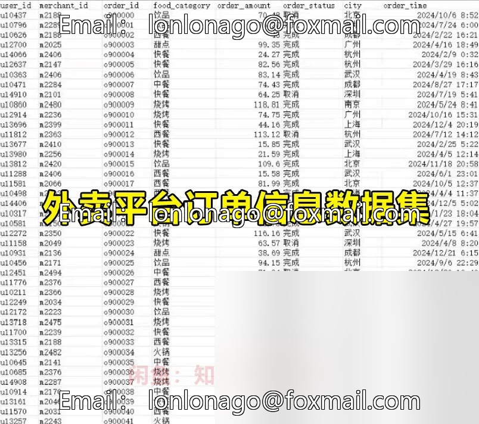

# Food delivery platform order information dataset

## Body

Food delivery platform order information dataset
Data source: a certain food delivery platform
Data structure: excel, csv, with a total of 152000 records
Data time: Jan to Dec 2024

1. Field descriptions
user_id (User ID), merchant_id (Merchant ID), order_id (Order ID), food_category (Food category), order_amount (Order amount), order_status (Order status: Completed/Cancelled), city (City), order_time (Ordering time)

2. Time span: January to December 2024 (full year data).

III. The orders cover 8 core cities:
Guangzhou (19,204), Chengdu (19,139), Beijing (19,071), Wuhan (19,032), Hangzhou (18,983), Nanjing (18,900), Shenzhen (18,854), Shanghai (18,817).

4. Data covers 7 categories of dining:
Hotpot (21,854), BBQ (21,824), Western food (21,725), Chinese food (21,686), desserts (21,683), fast food (21,651), beverages (21,577).

web-based shipment, can be directly photographed and shipped.

The dataset contains order information from a certain delivery platform, sourced from a platform and covering fields such as user ID, merchant ID, order ID, food category, order amount, order status, city and ordering time; it spans the full year and eight core cities across seven food categories.

<!-- AI_ENRICHED -->

## Images

## Payment

Here is a pay link on Stripe ( https://buy.stripe.com/3cs8yP7sY87d0vu9AB ). Please contact me lonlonago@foxmail.com after funding $89, and I will send you a complete data files , thank you!

